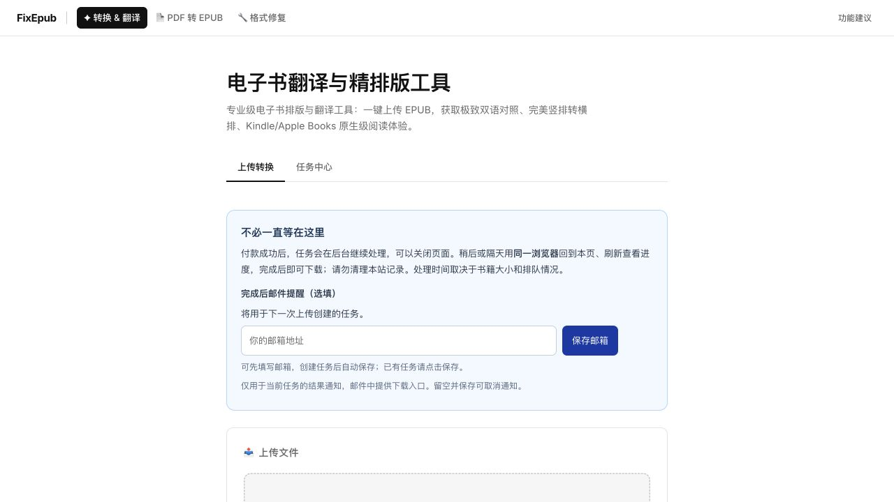

# 历史实现、验证与发布记录

2026-10-12 整理此前仅在本地保存的 15 份文档和 3 张截图。15 份文档经历史状态标注、客户信息脱敏及引用检查后归档；公开首页截图入库，两张已登录备案后台截图仅在本地保留并加入 Git 忽略规则。原始材料与既有备份未删除。

这些记录解释当时做过什么、观察到什么及有哪些验收边界，不是当前产品说明或生产操作手册。归档未重新执行历史测试、付款、模型调用、邮件发送、备案提交或部署；历史测试数量、费用估算和状态仅引用留存记录。私有书籍、OCR 响应、数据库、凭据和运行产物不随文档入库。

## 当前阅读入口

- [README](../README.md)：当前产品入口及开发方式。
- [部署说明](DEPLOY.md)：当前发布流程。
- [代码架构](ARCHITECTURE-DIAGRAM.md)与 [PDF 范围说明](PDF-TRANSLATION-ARCHITECTURE.md)：新版设计及其历史演进。
- [2026-10-12 生产端到端验证](PRODUCTION-E2E-2026-10-12.md)：`967e8b2` 的重复上传恢复及批量下载验收。
- [2026-10-12 后续发布记录](PRODUCTION-RELEASE-2026-10-12-MANUAL-REVIEW.md)：`6a6fc1e` 的 CI、部署、人工排查提示与翻译文案线上验证。
- [2026-10-13 已付订单恢复](PAID-ORDER-RECOVERY-2026-10-13.md)：CASE-C、CASE-D 的生产恢复、成品验收及安全下载验证；翻译复核提示与验收边界单列。

旧记录里的 PDF OCR／翻译公共入口、价格和开关不能套用于当前独立文字型 PDF → 原文 EPUB 产品。旧 `job_dispatches`、每 5 分钟对账和部分精校错误码已被新版实现替代。旧文档中的“未提交”“已部署”“待处理”均指记录当时；客户订单最终处置、备案申请状态未在本次归档重新查询。

## 文档清单

| 日期 | 记录 | 阅读时注意 |
| --- | --- | --- |
| 09-22，09-27 补充 | [PDF 首版实现](PDF-IMPLEMENTATION.md) | 旧 OCR／翻译链及配置，非当前启用方案 |
| 09-22 | [PDF 样本修复](PDF-ACCEPTANCE-FIXES-2026-09-22.md) | 真实响应离线回放，非重新调用供应商 |
| 09-22 | [PDF 并发与翻译验收](PDF-TDD-ACCEPTANCE-2026-09-22.md) | 小样本与故障注入，非长期稳定性证明 |
| 09-26 | [支付后交付可靠性](DELIVERY-RELIABILITY-2026-09-26.md) | 旧派发／对账方案，当前以新版架构为准 |
| 09-26 | [失败订单隔离重跑](FAILED-ORDER-REVALIDATION-2026-09-26.md) | CASE-A–E 匿名案例；隔离验收不等于客户交付 |
| 09-27 | [旧 PDF 服务部署](DEPLOY-REVIEW-2026-09-27.md) | 当时开放的旧服务，非当前配置状态 |
| 09-27 | [伽罗瓦理论样本验证](PDF-GALOIS-VALIDATION-2026-09-27.md) | 六页 OCR 存在问题，未作为完整成品放行 |
| 09-27 | [PDF 排版与忠实度复验](PDF-READABILITY-2026-09-27.md) | 离线缓存复验，仍有未完成的验收范围 |
| 09-27 | [前 20 页原文 EPUB 验证](PDF-POWER-VALIDATION-2026-09-27.md) | 指定页范围验证，不代表全书或通用流水线验收 |
| 09-27 | [旧 PDF 独立服务计费](PDF-SERVICES-2026-09-27.md) | 历史报价及开关，不能用作当前收费说明 |
| 09-29 | [中文书名质检与订单恢复](ORDER-TITLE-RECOVERY-2026-09-29.md) | CASE-F 匿名案例；SMTP 接受不等于客户阅读 |
| 09-29 | [超时自动续跑](TIMEOUT-CONTINUATION-2026-09-29.md) | 保留旧版修复证据，当前执行调度已升级 |
| 09-29 | [网站服务文案](SERVICE-COPY-2026-09-29.md) | 当时的文案与截图，不是备案通过证明 |
| 09-29 | [备案退回草稿记录](compliance/公安备案重新申请-2026-09-29.md) | 未确认持久保存／重新提交；引用未作现行法律复核 |
| 10-10 | [公司资料静态页部署](COMPANY-INFO-DEPLOY-2026-10-10.md) | 定向静态发布记录，后续整包发布另见上方入口 |

## 截图处理

| 原始文件 | 本次处理 | 说明 |
| --- | --- | --- |
| `artifacts/service-copy-20260929/homepage.png` | 以 `homepage.jpg` 入库 | 原文件实际为 JPEG，按原始字节更正扩展名；显示公开首页且邮箱输入框为空，仅作 2026-09-29 界面记录 |
| `artifacts/beian-20260929/pending-materials.png` | 本地保留、Git 忽略 | 登录后的备案主体与申请表单页面；文档保留必要的流程摘要 |
| `artifacts/beian-20260929/restored-application.png` | 本地保留、Git 忽略 | 登录后的备案申请资料及表单状态；不作为公共技术文档附件 |

## 脱敏与证据边界

客户复盘采用跨文档一致的 CASE 代号，删除订单号、客户书名与原始文件名、邮箱线索、实付金额及客户书稿／成品指纹。示例文件名含 CASE 代号，不是真实可查询路径；对应原始记录仍在私有材料中。PDF 验证样本名称、技术统计、源码／发布包摘要与无凭据的证据目录用于说明测试范围。

命令块保留用于理解当时的复验方法，不自动执行、不视为当前操作授权。文中以代码文本列出的私有产物路径是历史证据位置，不保证在其他开发机存在，也不添加原书或运行数据来补齐这些路径。
